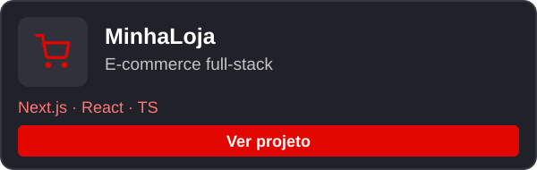
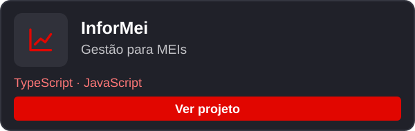
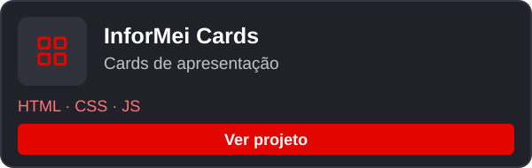
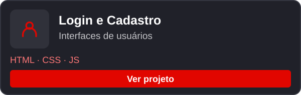
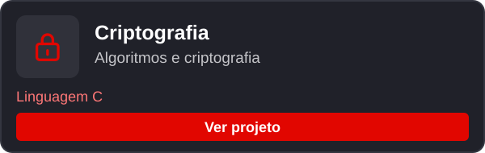
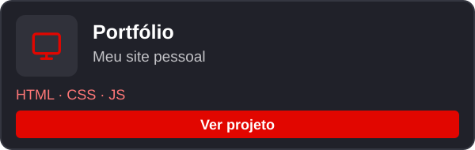

  
  

  

### Sobre

Sou desenvolvedor Front-End e busco me tornar Full Stack. Tenho conhecimentos em HTML, CSS, JavaScript, React, PHP e MySQL, e estou sempre buscando evoluir na área de tecnologia.

Cursando Ciência da Computação. 
Formado em Técnico em Desenvolvimento de Sistemas.

  
  
  
  
  
  
  
  
  
  
  
  
  

### Projetos em destaque

<table align="center">
  <tr>
    <td width="50%" align="center" valign="top">
      
    </td>
    <td width="50%" align="center" valign="top">
      
    </td>
  </tr>
  <tr>
    <td width="50%" align="center" valign="top">
      
    </td>
    <td width="50%" align="center" valign="top">
      
    </td>
  </tr>
  <tr>
    <td width="50%" align="center" valign="top">
      
    </td>
    <td width="50%" align="center" valign="top">
      
    </td>
  </tr>
</table>

  
  

<picture>
  <source media="(prefers-color-scheme: dark)" srcset="https://raw.githubusercontent.com/Matheussil01/Matheussil01/pacman-output/pacman-contribution-graph-dark.svg?game=pacman">
  <source media="(prefers-color-scheme: light)" srcset="https://raw.githubusercontent.com/Matheussil01/Matheussil01/pacman-output/pacman-contribution-graph.svg?game=pacman">
  
</picture>

<h4 align="center">Contatos 
LinkedIn: <a href="https://www.linkedin.com/in/matheussil01/">linkedin.com/in/matheussil01</a> 
Gmail: <a href="mailto:Matheussil2012@gmail.com">Matheussil2012@gmail.com</a></h4>

  
  
  

  

